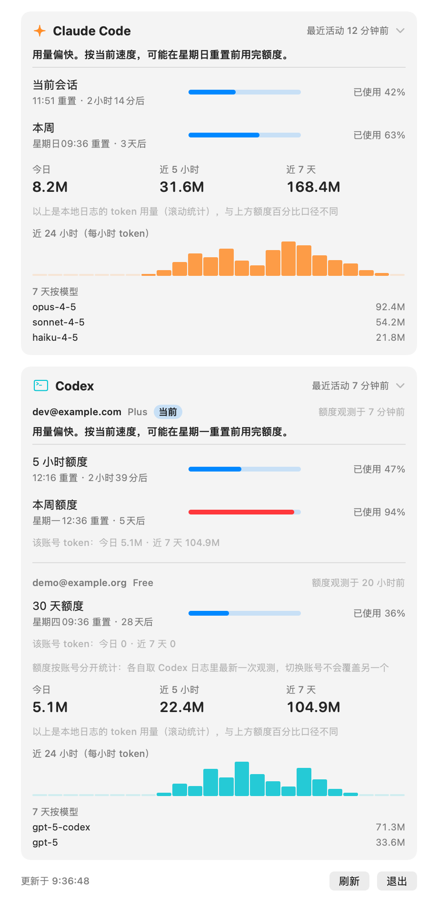

# UsageMonitor

macOS 菜单栏常驻的 AI 编码助手用量监控：一屏看到 Claude Code 与 Codex 各自的额度、重置时刻，以及**按账号分开**的余量。

纯本地运行，无遥测、无上传。唯一的网络请求是向 Anthropic 官方 `api.anthropic.com/api/oauth/usage` 查 Claude 额度。



## 它回答三个问题

同时用 Claude Code 和 Codex、还各有多个账号时，真正要紧的只有三件事：

1. **现在还能不能跑** —— 5 小时窗口还剩多少
2. **什么时候回满** —— 重置时刻 + 倒计时
3. **哪个账号还有余量** —— 多账号横向对比，不用切过去看

## 两个值得记下来的实现结论

### 1. Codex 多账号不能靠 `session_meta.creator_account_id` 归因

一开始的设计是按 rollout 文件里的 `creator_account_id` 分组，看起来天经地义。实测把这个假设推翻了：

> 某账号登录的 1 小时窗口内共产生 **246 条**额度观测，其中 **225 条写在另一个账号名下的旧会话文件里**。

原因：Codex 恢复旧会话时会继续往**原文件**追加记录，而 `rate_limits` 反映的永远是「观测发生那一刻登录的账号」，不是「这个文件属于谁」。

所以正确做法是维护一份登录时间线——监听 `~/.codex/auth.json` 的 mtime 变化，解析其中的 id_token 拿到 `account_id / email / plan`，按**观测时刻**归因；文件里的账号字段只能做交叉校验。

这一点靠读代码或读文档都发现不了，只有真的在两个账号之间切换过一次才看得见。

### 2. 窗口过期不等于 0%

额度窗口（`resets_at`）过去之后，真实剩余量是「**未知**」，不是 0%。

早期实现直接返回 `0`，配上「已重置」文案，界面看起来就像额度刚刚回满——你会据此放心开一个大任务，然后撞上 429。最讽刺的是它出错的方向恰好指向「可以放心用」。

现在过期状态返回 `nil`：进度条画成灰条、副标题写「窗口已重置，等待新数据」，菜单栏显示 `–%` 而不是 `0%`。宁可说「不知道」，不给一个看着舒服的错数。

## 数据来源

| 数据 | 来源 | 是否需要网络 |
|---|---|---|
| Claude 额度 | 钥匙串 `Claude Code-credentials` → `/api/oauth/usage` | 是（仅 Anthropic） |
| Codex 额度 | `~/.codex/sessions/**/*.jsonl` 的 `token_count.rate_limits` | 否 |
| Token 用量 | 两侧本地日志逐条增量 | 否 |
| 账号身份 | `~/.claude.json` 的 `oauthAccount`；`~/.codex/auth.json` 的 id_token 声明 | 否 |

Codex 侧**不走 API、只读日志**，因此额度新鲜度取决于最后一次运行 `codex` 的时间——界面上会标注「观测于 X 前」。这是刻意的取舍：不替你发请求，就不会有额外限流风险。

## 构建

要求 macOS 14+、Xcode 命令行工具。**零第三方依赖**，不需要 Xcode 工程或 SwiftPM：

```bash
./build.sh                 # 编译并打包成 build/UsageMonitor.app
open build/UsageMonitor.app
```

签名方式为 ad-hoc（`codesign --sign -`），首次打开需在「系统设置 → 隐私与安全性」放行一次。

菜单栏应用，`LSUIElement=true`，不占 Dock。

## 界面

- 卡片支持**抽屉式折叠**，状态持久化到 UserDefaults，下次打开保持
- 折叠后头部仍显示摘要（`5h 47% · 本周 94%`），异常状态不会被折叠藏起来
- 每张卡片可展开看近 24 小时柱状图、近 7 天按模型拆分

## 已知限制

- **冷启动首次扫描约 20-25 秒**（要回读 8 天日志），之后走增量
- 历史账号的额度停留在**最后一次观测**，不切换回去就不会更新——这是日志式数据源的固有限制，界面上有明确标注
- 菜单栏只显示当前账号的百分比；多账号对比需要点开面板
- 仅在 Apple Silicon + macOS 14 上验证过

## 许可

MIT
